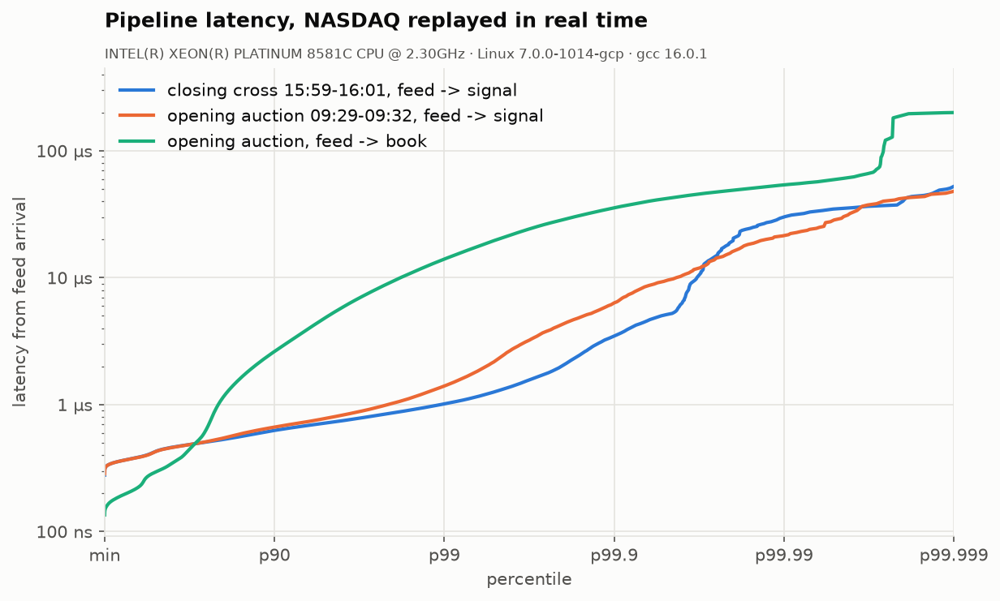

# NASDAQ ITCH 5.0 feed handler and order book (C++26)

A low-latency market-data feed handler that rebuilds the **full-depth limit
order book for every NASDAQ instrument** from raw market-by-order data, with
the complete toolchain to prove it is fast and correct: zero-copy decoding,
MoldUDP64 gap detection, a cache-aware book, a sharded pipeline on isolated
cores, differential testing, and latency measured on **a real trading day
replayed in real time**.

Tested on **NASDAQ TotalView-ITCH 5.0, 30 Dec 2019, the full day: 268,744,780
messages, 8,906 instruments**, on a GCP `c4-standard-16` (Xeon Platinum 8581C,
SMT off, cores isolated with `isolcpus`/`nohz_full`).

| | |
|---|---|
| **Full day, 3 book shards** | **9.67 s** (27.8 M msg/s), was 37.2 s before optimisation |
| **Book update, one core** | **63.5 ns/msg** (15.7 M msg/s), **3.3×** a `std::unordered_map` + `std::map` book |
| **Add / delete order, p50 · p99** | **35 · 177 ns** / **40 · 201 ns** |
| **Feed → strategy signal, closing cross in real time** | **p50 431 ns · p99 1.03 µs · p99.9 3.5 µs** |
| **Feed → strategy signal, opening auction in real time** | **p50 431 ns · p99 1.42 µs · p99.9 6.3 µs** |
| **Decode only** | 8.1 ns/msg (124 M msg/s, 2.9 GB/s) |
| **Correctness** | 0 integrity errors in 268.7 M messages; 4 book implementations identical after every message (50 M checked); decoded closing crosses match published closes (AAPL 291.52, MSFT 157.59, AMZN 1846.89, TSLA 414.70) |



## Architecture

```
 capture (mmap) ─► FrameReader ─┐            MoldUDP64 packets ─► mold::Receiver (gaps, dups)
                                ▼                                        │
                    feed thread (CPU 4): frame, stamp arrival, route by stock_locate
                       │ SPSC ring           │ SPSC ring           │ SPSC ring
                       ▼                     ▼                     ▼
                 book shard 0 (CPU 5)   book shard 1 (CPU 6)   book shard 2 ...
                 decode in place, apply MBO event, detect top-of-book change
                       └─────────────── SPSC rings ───────────────┘
                                          ▼
                    strategy thread (CPU 7): microprice, queue imbalance,
                    order-flow imbalance (Cont-Kukanov-Stoikov)
```

* **Zero-copy decoding.** All 23 ITCH message types are byte-exact overlays
  (`std::start_lifetime_as`). Every `sizeof` is checked against the spec at
  compile time, and fields are decoded on read (one load + `BSWAP`).
* **Order book.** A direct-mapped open-addressing order table (exploits
  NASDAQ's sequential order references), with backward-shift deletion, 2 MB
  pages and no allocation per order. Price levels are a sorted vector with the
  best price at the back, because order flow clusters at the touch.
* **Software-pipelined prefetching.** The handler looks 8 messages ahead and
  prefetches the order slot and book each one will touch. The order table fell
  from 47 % to 12 % of the profile.
* **Sharded by instrument.** Every ITCH message carries its instrument, so each
  shard owns its orders outright, shares nothing, and scales 3.07× on 3 cores.
* **Measured properly.** TSC timestamps, coordinated-omission-safe pacing,
  latency histograms over hundreds of millions of messages, an OS-noise probe,
  and `perf` flame graphs.

## Docs

| | |
|---|---|
| [docs/RESULTS.md](docs/RESULTS.md) | **All results**: machine, correctness, throughput, latency, every optimisation with before/after, lessons |
| [docs/DESIGN.md](docs/DESIGN.md) | Decoder, MoldUDP64, order table, price levels, prefetching, sharding, C++26 features |
| [results/](results/) | Raw outputs: per-stage latency histograms, benchmark JSON, flame graphs, per-symbol CSVs, `SUMMARY.md` |

## Build and run

Needs **GCC 16** (C++26 reflection and contracts), CMake ≥ 3.25, Ninja.
Google Benchmark and GoogleTest are fetched by CMake.

```bash
cmake --preset release && cmake --build --preset release
ctest --preset release                                   # unit + differential + pipeline tests

# a full NASDAQ day (~3.5 GB download, ~8 GB unpacked)
scripts/fetch_nasdaq_day.sh 12302019 ~/data 32
F=~/data/12302019.NASDAQ_ITCH50.bin

build/release/itch_replay $F --mode=stats                              # what is in the day
build/release/itch_replay $F --mode=inline                             # book build, per-type latency
build/release/itch_replay $F --mode=pipeline --cpus=4,5,6,7,3          # feed, 3 book shards, strategy
build/release/itch_replay $F --mode=pipeline --pace=replay:1 \
    --window=15:59:00-16:01:00 --cpus=4,5,6,7                          # closing cross in real time
CPUS=4,5,6,7,3 scripts/run_all.sh $F my_run                            # everything + plots
```

No data? `build/release/itch_gen feed.bin --messages=20000000` writes a
protocol-valid synthetic feed.

## Tests

29 GoogleTest tests: golden-byte decoding from the spec's
offsets, MoldUDP64 gaps, duplicates and heartbeats, the order table against a
`std::unordered_map` model under churn, book semantics for every message type,
**differential testing of four book implementations after every message**
(2 M synthetic messages, plus 50 M real ones with `ITCH_FILE`), and the
sharded pipeline against a single-threaded replay. C++26 contracts are checked
in tests and compiled out of measured builds.

## Related

[spsc-ring-buffer](https://github.com/mohith-reddy-seelam/spsc-ring-buffer):
the lock-free queue between the pipeline stages, with its own latency
benchmarks and write-up.

MIT licensed. NASDAQ data is not included; it is downloaded from NASDAQ's
public sample server by the script above.
