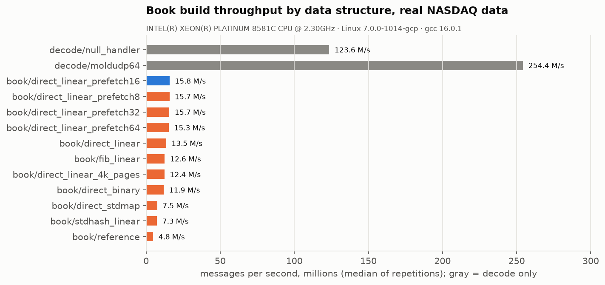

# Results: one full NASDAQ trading day

Every number here comes from `results/nasdaq_20191230_c4/` (final code) and
`results/nasdaq_20191230_c4_baseline/` (before the optimisations in §5),
produced by `scripts/run_all.sh`. The raw files (latency histograms,
per-repetition Google Benchmark JSON, flame graphs, per-symbol CSVs) are
committed next to the plots.

## 1. Data and machine

| | |
|---|---|
| Data | NASDAQ TotalView-ITCH 5.0, **30 December 2019, the full day**: 8.25 GB, **268,744,780 messages**, 8,906 instruments, 03:04:32 to 20:05:00 exchange time. Downloaded from NASDAQ's public sample server (`scripts/fetch_nasdaq_day.sh`); not redistributed here |
| Machine | Google Cloud `c4-standard-16`, Intel Xeon Platinum 8581C (Emerald Rapids), **8 physical cores, SMT off**, 58 GB RAM |
| OS | Ubuntu 26.04, Linux 7.0, **cores 4-7 isolated**: `isolcpus=nohz,domain,managed_irq,4-7 nohz_full=4-7 rcu_nocbs=4-7 irqaffinity=0-3`, irqbalance off |
| Compiler | GCC 16 (16.0.1 snapshot, 2026-03-22), `-O3 -march=native -std=c++26 -freflection`, 2 MB pages via `madvise` |
| Threads | feed on CPU 4, book shard(s) on CPUs 5 / 6 / 7, strategy on CPU 7 (latency layout) or CPU 3 (3-shard throughput layout) |

### Noise floor of the isolated cores

A pinned thread spins on the TSC and records every gap over 1 µs
(`itch_replay --mode=noise`):

| CPUs 4-6 | interruptions / s | CPU time stolen | worst gap |
|---|---:|---:|---:|
| before isolation | ~1,080 (the 1 kHz scheduler tick) | 0.52 % | 441 µs |
| **after isolation** | **~15** | **0.01 %** | 70 µs |

What remains is most likely hypervisor exits, which only bare metal removes.

## 2. Correctness on real data

* **Zero integrity errors over the whole day**: no unknown message types, no
  bad lengths, no reference to an unknown order, no price level missing for a
  resting order, across all 268.7 M messages.
* **Differential test**: four book implementations (direct-mapped and Fibonacci
  hashing, linear and binary level search, and a textbook
  `std::unordered_map` + `std::map` book) agree on the touched instrument's top
  of book **after every one of the first 50 M messages**, and on full depth for
  all 8,893 instruments touched (`differential_test.log`).
* **External check**: the official NASDAQ closing-cross prices decoded from the
  raw feed (`Q` messages, cross type `C`) match the published 30 Dec 2019
  closes: **AAPL 291.52, MSFT 157.59, AMZN 1846.89, TSLA 414.70**
  (`inline/symbols.csv` has every instrument).
* The book is empty at 20:05, as it must be: NASDAQ removes all resting orders
  after the session.
* Sharded pipeline = single thread: a test checks that a 3-shard run ends with
  identical books and identical top-of-book changes.

## 3. Throughput

### Full day through the pipeline (feed → book shards → strategy)

| book threads | full day | messages / s |
|---|---:|---:|
| baseline, 1 (before §5) | 37.18 s | 7.2 M |
| 1 | 28.9 s | 9.3 M |
| 2 | 14.3 s | 18.8 M |
| **3** | **9.67 s** | **27.8 M** |

Shard load with `stock_locate % 3`: 29.4 / 34.8 / 35.8 %. Every pipeline run
also records arrival → book latency per message (two TSC reads plus a
histogram update), which is included in these times.

### One core, by data structure (Google Benchmark, median of 3, full day)

| implementation | ns / msg | M msg/s | vs textbook |
|---|---:|---:|---:|
| decode only (frame + dispatch, no book) | 8.1 | 123.6 | |
| `std::unordered_map` + `std::map` (textbook) | 209.6 | 4.8 | 1.0× |
| `std::unordered_map` orders + vector levels | 136.5 | 7.3 | 1.5× |
| direct-mapped orders + `std::map` levels | 133.9 | 7.5 | 1.6× |
| direct-mapped + vector levels, binary search | 84.1 | 11.9 | 2.5× |
| Fibonacci-hashed + vector levels, linear | 79.6 | 12.6 | 2.6× |
| direct-mapped + vector, linear, 4 KB pages | 80.6 | 12.4 | 2.6× |
| direct-mapped + vector, linear, 2 MB pages | 74.1 | 13.5 | 2.8× |
| **… + software prefetch, 8 ahead (default)** | **63.5** | **15.7** | **3.3×** |

## 4. Latency

### Book update, per message type, full day, single thread

Timed individually with two TSC reads (~10 ns of the figure is the timer).

| message | count | p50 | p99 | p99.9 |
|---|---:|---:|---:|---:|
| AddOrder | 117.1 M | 35 ns | 177 ns | 361 ns |
| OrderDelete | 114.4 M | 40 ns | 201 ns | 382 ns |
| OrderReplace | 21.6 M | 95 ns | 514 ns | 876 ns |
| OrderExecuted | 5.7 M | 31 ns | 177 ns | 361 ns |
| OrderCancel | 2.8 M | 32 ns | 156 ns | 292 ns |

Baseline (before §5): AddOrder 132 / 368 / 487 ns, OrderDelete 81 / 354 / 514 ns.
Most of the drop is prefetching. The baseline's timer also wrapped the dispatch
`switch`, which the final one does not (a few ns at most).

### Feed arrival → strategy signal, NASDAQ replayed in real time

The pipeline first replays everything before the window flat out (building the
full book, not measured), lets the queues drain, then replays the window at
the exchange's own pace. Latency counts from the scheduled arrival time
(coordinated-omission safe). Latency layout: 2 book shards, every thread on
an isolated core.

| window | messages | top-of-book changes | p50 | p90 | p99 | p99.9 |
|---|---:|---:|---:|---:|---:|---:|
| **closing cross**, 15:59-16:01 | 5.55 M | 1.81 M | **431 ns** | 640 ns | **1.03 µs** | **3.5 µs** |
| **opening auction**, 09:29-09:32 | 3.95 M | 0.81 M | **431 ns** | 667 ns | **1.42 µs** | **6.3 µs** |

* Where the ~430 ns median goes: arrival → book applied is ~295 ns (p50), and
  book → strategy adds ~135 ns. The book update itself is 35-40 ns; the rest
  is the cross-core hand-offs through the rings (cache-line transfers between
  cores, which cost more on a VM than on bare metal).
* **Feed → book** at the open has a long p90-p99 (2.7-14 µs). That is genuine
  queueing: at 09:30:00 the opening cross releases thousands of messages with
  the same exchange timestamp, so the *k*-th waits for the *k-1* before it.
* **Layout matters more than shard count for tails.** The same windows with 3
  shards and the strategy thread on the non-isolated CPU 3 give a worse p99.9
  (close 5.0 µs, open 6.9 µs) for the same throughput.
* At sparse traffic (pre-market, ~200 msg/s), the median rises to ~1.3 µs:
  the book's cache lines go cold between messages. Production systems keep
  them warm with synthetic traffic.

## 5. What made it faster, measured

The baseline `perf` profile put **~47 % of all time in the order table**
(`insert` 28.6 %, `find` 15.6 %, `erase` 3 %): cache misses, not computation.
Each change below was measured on the full day and kept only if it won.

| change | effect (full day) | kept |
|---|---|---|
| Direct-mapped order table (`ref & mask`) instead of Fibonacci hashing | 79.6 → 74.1 ns/msg (7 %) | yes |
| 2 MB pages for the order table | 80.6 → 74.1 ns/msg (+9 % in this run, +4 % in an earlier one) | yes |
| Software prefetch of each message's order slot and book, 8 messages ahead | 74.1 → **63.5 ns/msg (+17 %)**; per-message p50 for adds 132 → 35 ns | yes |
| Prefetch distance 8 / 16 / 32 / 64 | 63.5 / 63.3 / 63.6 / 65.3 ns: a plateau, then worse | 8 |
| Shard the book across cores by instrument | **3.07×** pipeline throughput with 3 shards | yes |
| PGO (trained on the first 30 M messages) | +5.5 %, consistent over 3 runs each side | optional (`scripts/pgo_build.sh`) |

After prefetching, the order table falls from ~47 % to ~12 % of the profile,
and the top item becomes the price-level search (`upper`, 11 %): the next
thing to work on.
([baseline flame graph](../results/nasdaq_20191230_c4_baseline/book_build_flamegraph.svg),
[final flame graph](../results/nasdaq_20191230_c4/book_build_flamegraph.svg))

## 6. Lessons that changed the code

* **Small samples lie about memory optimisations.** On the first 1.2 M
  pre-market messages (5,800 live orders, all in cache), direct mapping looked
  61 % faster and prefetching looked 16 % *slower*. On the full day (1.9 M
  live orders) the numbers are +7 % and +17 %. Every decision above was made
  on the full day.
* **A 2.9 M msg/s "pipeline bottleneck" was a measurement bug.** The first
  call to the TSC calibration sleeps 300 ms, and it ran inside the timed region.
* **An unfenced `RDTSC` can read before an earlier store on another core**,
  which showed up as a "negative latency" (a max of 8×10¹⁸ ns). Stage
  timestamps now use `RDTSCP` + `LFENCE` and are clamped.
* **A test that checks nothing passes.** The first differential test checked 0
  messages because of a `limit == 0` bug; the test now prints how many
  messages and instruments it compared.

## 7. Caveats

* One day, one machine, a VM: absolute tails include hypervisor noise, and
  bare metal would be cleaner. Ratios between implementations and the
  optimisation effects are the transferable results.
* Replay reads from memory (a captured file), not from a NIC: there is no
  socket or kernel network stack in these numbers.
* Run-to-run variation on the full-day benchmark is up to ~6 %. Effects
  smaller than that (huge pages, PGO) were repeated before being reported.
* The GCC 16 build is a pre-release snapshot (Ubuntu 26.04 package); the
  Windows build used GCC 16.2.
